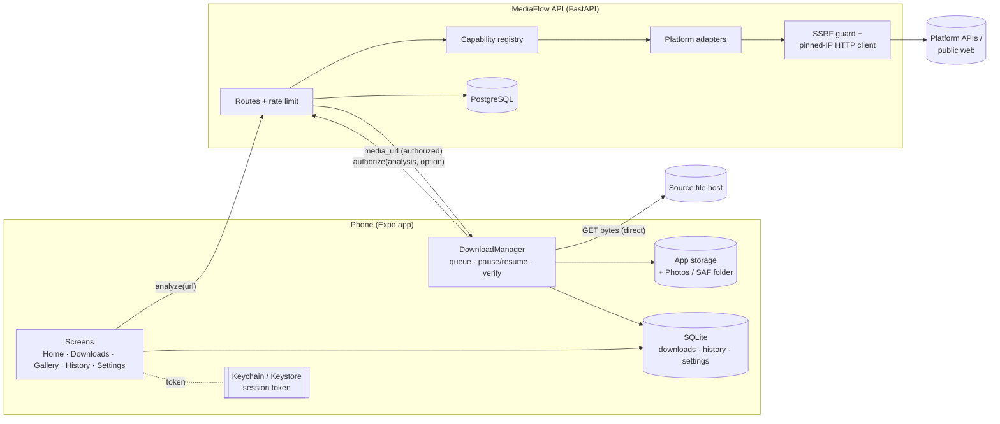

# Stage 2 — Architecture

## System overview

**Key decision — the server authorizes, the phone transfers.** The API decides *whether* and *what* may be downloaded and returns a single authorized URL per request. Bytes go straight from the source to the device. Consequences: no media is ever stored on (or proxied through) the server, bandwidth costs stay flat, and there are no temporary server files to leak.

## Request lifecycle

1. `POST /media/analyze {url}`
   - normalise (extract link from shared text, strip tracking params) → static SSRF checks (scheme, port, credentials, blocked hostnames, literal private IPs)
   - registry picks the adapter by exact host match (look-alikes like `youtube.com.evil.net` fall through to the generic adapter)
   - adapter talks **only to its allow-listed API hosts**, through the SSRF-guarded client
   - result is stored for 15 min as `media_analyses` with the public part (options) and the private part (actual media URLs) separately; only the public part is returned
2. `POST /downloads {analysis_id, option_id}` → re-checks ownership, expiry, size limit → returns a **download ticket** (`media_url`, headers, `max_bytes`) and creates a `downloads` record
3. Device downloads, verifies, saves, and reports `PATCH /downloads/{id}` (`in_progress` / `completed` / `failed` + error code). If the user disabled server history, records are deleted on completion.

## Adapter interface (`backend/app/platforms/base.py`)

| Concern | Member |
|---|---|
| Platform identification | `key`, `name`, `domains`, `matches(host)` |
| Capability registry entry | `capabilities`, `download_mode`, `media_types`, `summary`, `limitations`, `alternatives`, `info()` |
| Configuration / authorization | `is_configured(settings)`, `requires_connection`, `oauth_provider` |
| URL validation | per-adapter ID parsers raising `UnsupportedLink` |
| Metadata + options | `analyze(url, ctx) -> AdapterResult` |
| Error reporting | `AdapterError(code, message)` → `unavailable` with explanation |
| Official fallback | `official_url(url)`, `alternatives` |

Download modes: `direct` (public files), `connected_account` (user's own content via OAuth), `operator_api` (operator credentials, opt-in), `link_only`, `export_only`.

## Security model

| Threat | Control | Where |
|---|---|---|
| SSRF to internal services / cloud metadata | scheme+port allow-list, blocked hostnames, every resolved IP must be global (incl. IPv4-mapped/6to4/Teredo/NAT64 unwrapping, CGNAT, link-local) | `security/netguard.py` |
| DNS rebinding | connect to the **vetted IP**, keep `Host` + TLS SNI/cert check on the hostname | `security/http_client.py` |
| Open/unsafe redirects | manual redirect following, re-vetting each hop, no https→http, per-call host allow-list, max 3 hops | same |
| Credential leakage via redirect | `Authorization`/`Cookie` stripped on cross-host hop; HTTP Basic only on first hop | same |
| Unrestricted fetcher | adapters pin to API hosts; generic adapter refuses platform CDNs — checked on the first URL **and every redirect hop** — and streaming manifests; body caps (64 B probe, 512 KB HTML) | `platforms/*`, `http_client.py` (`blocked_hosts`) |
| OAuth account-linking CSRF | token parked server-side after the callback and attached only via an authenticated `complete` call carrying the app-held verifier | `api/connections.py` |
| Spoofed client IP / scheme | forwarded headers trusted only from `FORWARDED_ALLOW_IPS` (default 127.0.0.1) | `Dockerfile` |
| File-type spoofing / malware | magic-byte sniffing server-side (probe) **and** on-device (downloaded file) — executables, archives, PDFs, HTML/SVG are rejected, declared vs real type must match | `security/mime.py`, `src/lib/fileSignature.ts` |
| Path traversal in names | NFKC, strip separators/control/bidi chars, reserved names, forced extension | `security/filenames.py`, `src/lib/filenames.ts` |
| Abuse | sliding-window rate limits per IP and per principal; body size cap | `security/ratelimit.py`, `main.py` |
| Stolen DB | Argon2id passwords, SHA-256 session tokens, Fernet-encrypted OAuth tokens | `security/crypto.py` |
| Secrets in the app | none bundled; app holds only the public API URL; OAuth secrets stay server-side | `app.config.ts` |
| Transport | HTTPS required in production (startup refuses otherwise), HSTS, release builds refuse `http://` API URLs | `main.py`, `src/api/client.ts` |

## Database schema (PostgreSQL)

Defined in `backend/app/models.py`, migration `alembic/versions/0001_initial.py` (verified identical with an Alembic autogenerate diff), rendered DDL in `docs/schema.postgres.sql`.

| Table | Purpose | Retention |
|---|---|---|
| `users` | anonymous or registered principal; `keep_server_history` flag | until account deletion |
| `sessions` | SHA-256 of bearer tokens, expiry | 30 days, purged when expired |
| `oauth_connections` | encrypted platform tokens, one per user+platform | until disconnect / account deletion |
| `oauth_states` | single-use OAuth `state` (hashed), verifier hash, handoff hash, encrypted pending token | 10 minutes (5 after the callback) |
| `media_analyses` | public result + private media URLs | 15 minutes |
| `downloads` | download records (no media) | 30 days; with history off, deleted as soon as a final status is reported |

Local (device) SQLite: `downloads`, `link_history` (≤500 rows), `kv` (settings).

## Screen map

| Tab / route | Purpose |
|---|---|
| `/(tabs)/index` Home | paste/analyze, preview, quality selector, download, official-link panel, connect account |
| `/(tabs)/downloads` | active/done/failed filters, search, sort, pause/resume/cancel/retry/share/delete |
| `/(tabs)/gallery` | offline grid of saved files, search, type filter |
| `/(tabs)/history` | analyzed links (local), re-analyze, delete, clear |
| `/(tabs)/settings` | theme, save location, concurrency, Wi-Fi only, connections, privacy & data, account deletion |
| `/player/[id]` | offline image viewer / video player, share, delete |
| `/platforms` | live capability registry from the server |
| `/account` | optional register / sign in / sign out |

## Online vs offline

| Works offline | Needs internet |
|---|---|
| Gallery, playback, share, delete files | Analyze link, start/resume downloads |
| Downloads list, search, history | Connect accounts, account actions |
| Settings (local ones) | Platform list, server history settings |

The Home tab shows an offline banner and disables **Analyze** when there's no connection.
